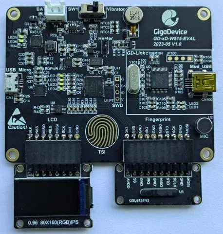

.. zephyr:board:: gd_xd_w515_eval

Overview
********

The GD-xD-W515-EVAL is a GigaDevice evaluation board for the GD32W515PIQ6, an Arm Cortex-M33
microcontroller with TrustZone, FPU and DSP at 180 MHz, 2 MB of SIP flash and 448 KB of SRAM.
It is made of a main board, an LCD board and a fingerprint sensor board.

   The GD-xD-W515-EVAL with the LCD and fingerprint modules plugged in.

Hardware
********

- GD32W515PIQ6 (QFN56), Cortex-M33 at 180 MHz from a 25 MHz HXTAL through the PLL
- 2 MB of internal (SIP) flash at ``0x08000000``, 448 KB of SRAM at ``0x20000000``
- On-board GD-Link probe (CMSIS-DAP, SWD) on the mini-USB connector, without a virtual COM port
- HDM340ED (CH340E compatible) USB-serial bridge on the micro-USB connector
- Four user LEDs, a capacitive touch key (TSI), a vibration motor and a heater output
- 0.96" 80x160 ST7735S LCD board and GSL6157 fingerprint sensor board
- GD25T28E 16 MB QSPI NOR flash
- GD30BC2416 battery charger, GD30LD1002 LDO, LiPo connector

The integrated Wi-Fi radio cannot be used on this board: the vendor radio libraries only
support 26 MHz and 40 MHz crystals, and the board has no antenna.

For more information about the GD32W515 SoC, see the GD32W515xx datasheet and the GD32W51x
user manual on the GigaDevice website.

Supported Features
==================

.. zephyr:board-supported-hw::

The RTC runs from the internal 32 kHz RC oscillator (``clock-source = "irc32k"`` in the SoC
devicetree), since the board has no 32.768 kHz crystal. Expect it to drift.

The ADC converts on 12 bits only, the GD32W51x has no resolution selection.

The GD25Q128E QSPI NOR flash (16 MiB) is the ``qspi-nor-flash@0`` flash device, with a single
``qspi_storage_partition`` that covers it; the driver uses the indirect mode of the QSPI
controller with single line commands, at 30 MHz. The QSPI is a Secure peripheral: the driver
keeps its pins Secure, while the GPIO driver releases the other pins to the Non-secure
peripherals.

Connections and IOs
===================

============== ==================================== ==========================
Function       Pins                                 Notes
============== ==================================== ==========================
Console        PB10 (TX), PB11 (RX)                 USART2, AF7, micro-USB
LEDs           PB1, PC4, PC5, PC3                   LED1..LED4, active high
I2C0           PB15 (SCL), PA8 (SDA)                GD30BC2416 charger
SPI0           PA11 (SCK), PA9 (MOSI)               LCD, CS PB13, DC PA10,
                                                    RST PC6
LCD backlight  PB0                                  TIMER2_CH1 PWM
SPI1           PC7 (SCK), PB6 (MISO), PB9 (MOSI)    fingerprint, CS PB8,
                                                    STD PB5, IRQ PA12
Motor          PA0                                  TIMER1_CH0 PWM
ADC            PA1, PA2, PA3, PC2                   IN1, IN2, IN3, IN6
Touch key      PB14 (electrode), PB12 (capacitor)   TSI group 2
USB detect     PC1                                  high with the micro-USB
Charger IRQ    PB2
QSPI flash     PA4 (SCK), PA5 (CS), PA6, PA7,       IO0..IO3, AF3
               PB3, PB4
SWD            PA13 (SWDIO), PA14 (SWCLK)
============== ==================================== ==========================

The charger only answers on I2C with a battery or a supply on the BAT connector.

Flash layout
============

The board devicetree partitions the 2 MB of flash (4 KB pages) for MCUboot, with
``zephyr,code-partition`` pointing at ``slot0_partition``:

======================== ========= ================================================
Range                    Size      Partition
======================== ========= ================================================
0x08000000 - 0x08020000  128 KiB   ``boot_partition`` (mcuboot)
0x08020000 - 0x08040000  128 KiB   ``storage_partition``
0x08040000 - 0x08118000  864 KiB   ``slot0_partition`` (image-0)
0x08118000 - 0x081f0000  864 KiB   ``slot1_partition`` (image-1)
0x081f0000 - 0x08200000  64 KiB    ``scratch_partition`` (image-scratch)
======================== ========= ================================================

Without MCUboot the application ignores the partitions and is linked at the start of the
flash. With ``west build --sysbuild`` and ``SB_CONFIG_BOOTLOADER_MCUBOOT=y`` the application
is linked into ``slot0_partition`` and MCUboot into ``boot_partition``; each slot has 216
pages, so MCUboot needs ``CONFIG_BOOT_MAX_IMG_SECTORS=256``. ``west flash`` programs each
image at the Secure alias of its partition.

TrustZone
=========

The board ships with TrustZone enabled (``TZEN`` option bit). Disabling it requires lowering
the security protection level, which mass erases the chip, so Zephyr runs as a Secure-only
image with the SAU disabled:

- The boot ROM enters the image through the Secure alias of the flash (``0x0c000000``); the
  image is linked at the Non-secure alias (``0x08000000``) and runs from there.
- Every bus transaction is Secure. The peripherals are reached through their Non-secure
  aliases (``0x4xxxxxxx``), the GPIO driver releases the pins to the Non-secure peripherals,
  the DMA channels are made Secure and the flash is erased and programmed through the Secure
  registers of the FMC.
- The flash pages that hold the image must be marked Secure. The factory setting only marks
  the first 32 KB (``FMC_SECMCFG0 = 0x00070000``): the CPU then faults as soon as it fetches
  code past them. Mark the whole flash once, with the GigaDevice OpenOCD and the GD-Link
  (this does not erase anything):

  .. code-block:: console

     openocd -f target/openocd_gdlink_gd32w51x.cfg -c init -c "reset halt" \
       -c "mww 0x50022004 0x45670123" -c "mww 0x50022004 0xCDEF89AB" \
       -c "mww 0x50022024 0x45670123" -c "mww 0x50022024 0xCDEF89AB" \
       -c "mww 0x50022008 0x45670123" -c "mww 0x50022008 0xCDEF89AB" \
       -c "mww 0x50022048 0x01FF0000" -c "mmw 0x50022010 0x4200 0" \
       -c "sleep 200" -c "mmw 0x50022010 0x8000 0" -c shutdown

.. note::
   With TrustZone enabled, the Secure debug port reads the Non-secure flash pages as zero.
   Back up the factory firmware only after all the pages are marked Secure.

Programming and Debugging
*************************

.. zephyr:board-supported-runners::

The on-board GD-Link is a CMSIS-DAP probe. Flashing it needs the GigaDevice fork of OpenOCD,
which has the ``gd32w51x`` flash driver; the mainline OpenOCD does not support the part. With
TrustZone enabled the flash driver registers the flash at its Secure alias, so the board
programs the raw binary at ``0x0c000000``.

Serial console
==============

The console is USART2 at 115200 8N1, on the micro-USB connector (``/dev/ttyUSB0`` on Linux).

Flashing
========

Here is an example for the :zephyr:code-sample:`hello_world` application.

.. zephyr-app-commands::
   :zephyr-app: samples/hello_world
   :board: gd_xd_w515_eval
   :goals: build flash
   :flash-args: --openocd /path/to/gigadevice/openocd/bin/openocd --openocd-search /path/to/gigadevice/openocd/scripts

Open a serial terminal on the micro-USB connector and reset the board; you should see:

.. code-block:: console

   *** Booting Zephyr OS build v4.4.0 ***
   Hello World! gd_xd_w515_eval/gd32w515

Debugging
=========

``west debug`` does not load the image: gdb would write it at the Non-secure alias of the
flash, where the GigaDevice OpenOCD has no flash bank. Program it with ``west flash`` first,
then attach:

.. zephyr-app-commands::
   :zephyr-app: samples/hello_world
   :board: gd_xd_w515_eval
   :goals: debug
   :debug-args: --openocd /path/to/gigadevice/openocd/bin/openocd --openocd-search /path/to/gigadevice/openocd/scripts
